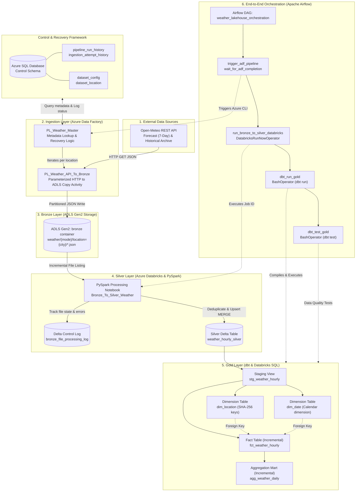

# Weather & Energy Lakehouse: Automated Medallion Data Platform

An enterprise-grade, end-to-end Data Lakehouse built on Microsoft Azure, Databricks, dbt, and Apache Airflow. The platform ingests, processes, harmonizes, and models multi-city weather data to power renewable energy forecasting, grid load correlation, and climate analytics using the **Medallion Architecture (Bronze -> Silver -> Gold)**.

---

## Architectural Overview

The platform uses a metadata-driven, decoupled design where each layer has dedicated responsibilities, state tracking, and failure recovery.



---

## Core Technologies & Tooling

| Domain | Technology | Purpose |
|---|---|---|
| **Cloud Infrastructure** | Microsoft Azure | Azure Data Lake Storage Gen2, Azure SQL Database, Azure Key Vault |
| **Data Ingestion** | Azure Data Factory (ADF) | Parameterized, metadata-driven REST API ingestion with automated retry & recovery |
| **Distributed Compute** | Azure Databricks (Apache Spark) | PySpark for raw JSON parsing, schema enforcement, window deduplication, and Delta MERGE |
| **Storage & Table Format** | Delta Lake (ACID) | Transactional storage, schema evolution, versioning, and time-travel capability |
| **Data Transformation** | dbt Core (Databricks SQL adapter) | Kimball star-schema dimensional modeling, incremental facts, daily aggregates, and tests |
| **Workflow Orchestration** | Apache Airflow | DAG-driven scheduling, parameter propagation, sensor polling, and cross-platform orchestration |
| **Source Data** | Open-Meteo REST API | High-resolution hourly weather observations (historical archive & 7-day forecast) |

---

## Repository Structure

```text
Weather-Energy-Lakehouse/
├── adf/                                    # Azure Data Factory source code & ARM configurations
│   ├── dataset/                            # Input/output dataset definitions (HTTP, ADLS, Azure SQL)
│   ├── factory/                            # Data Factory resource definition
│   ├── linkedService/                      # Linked services (Key Vault, SQL, ADLS Gen2, Open-Meteo HTTP)
│   ├── pipeline/                           # ADF pipeline JSON definitions
│   │   ├── PL_Weather_Master.json          # Master orchestration pipeline with dynamic metadata & recovery
│   │   └── PL_Weather_API_To_Bronze.json   # Parameterized worker pipeline for API extraction to Bronze
│   └── trigger/                            # Scheduled & event triggers
├── airflow/                                # Apache Airflow orchestration platform
│   └── dags/                               # Airflow DAG definitions
│       ├── weather_lakehouse_orchestration.py # Master end-to-end DAG (ADF -> Databricks -> dbt)
│       └── hello_weather_lakehouse.py      # Health-check verification DAG
├── Spark_notebook/                         # Databricks PySpark notebooks
│   └── Silver_layer/
│       └── Bronze_To_Silver_Weather.ipynb  # Incremental JSON extraction, deduplication, and Silver Delta MERGE
├── weather_energy_dbt/                     # dbt Core dimensional modeling project
│   ├── dbt_project.yml                     # dbt project configuration and paths
│   ├── macros/                             # Custom Jinja macros (schema naming, test watermarks)
│   └── models/
│       ├── staging/weather/                # Staging views over Silver Delta tables
│       │   ├── source.yml                  # Source schema definitions
│       │   └── stg_weather_hourly.sql      # Standardized weather view
│       ├── dimensions/                     # Kimball dimension tables
│       │   ├── dim_location.sql            # Location dimension with SHA-256 surrogate keys
│       │   ├── dim_date.sql                # Comprehensive calendar dimension (day, week, month, quarter)
│       │   └── schema.yml                  # Primary key uniqueness and non-null constraints
│       ├── facts/                          # Fact tables
│       │   ├── fct_weather_hourly.sql      # Incremental hourly weather fact table with foreign key joins
│       │   └── schema.yml                  # Referential integrity & metric data tests
│       └── aggregates/                     # Aggregated data marts
│           ├── agg_weather_daily.sql       # Incremental daily weather metrics (min/max/avg, precipitation)
│           └── schema.yml                  # Aggregation data tests
├── publish_config.json                     # ADF Git publishing configuration
└── README.md                               # Repository documentation and architecture guide
```

---

## Medallion Architecture Deep Dive

### 1. Ingestion Layer (Azure Data Factory & Control Framework)
- **Metadata-Driven Pipeline**: Ingestion is governed by tables in an Azure SQL Database (`control.dataset_config`, `control.dataset_location`). Location coordinates (Chennai, Bengaluru, Hyderabad) and endpoints are read dynamically at runtime.
- **Automated Failure Recovery**: `PL_Weather_Master` queries `control.pipeline_run_history` and `control.ingestion_attempt_history`. If a prior run failed or was partial, the pipeline automatically isolates and retries only the failed locations before processing new batches.
- **Dual Ingestion Modes**: Supports both `forecast` (7-day forward predictions) and `archive` (historical date-range backfills).

### 2. Bronze Layer (ADLS Gen2 Storage)
- **Storage Structure**: Raw JSON responses are landed into ADLS Gen2 `bronze` container using structured partitioning:
  `weather/{api_mode}/location={location}/{api_mode}_{start_date}_to_{end_date}_{run_id}.json`
- **Immutability**: Files in Bronze are retained in raw, unmutated form to preserve full lineage and allow deterministic reprocessing.

### 3. Silver Layer (Azure Databricks & Delta Lake)
- **Incremental File Detection**: Databricks scans ADLS Gen2 using REST API listings and compares each file against `workspace.default.bronze_file_processing_log`. Only new, modified (ETag/timestamp change), or previously failed files are processed.
- **Array Parsing**: Extracts multi-variable hourly arrays (`temperature_2m`, `relative_humidity_2m`, `precipitation`, `wind_speed_10m`) into structured relational rows.
- **Business Key Deduplication**: Applies PySpark window functions partitioned by `(location, weather_timestamp)` ordered by `source_last_modified DESC, source_file DESC` to guarantee exact-once record uniqueness.
- **Delta MERGE Upsert**: Merges records into `workspace.default.weather_hourly_silver`, updating existing rows only when measure values differ, preserving computation cycles.
- **Per-File Audit Logging**: Updates `bronze_file_processing_log` with file-level `SUCCESS` or `FAILED` statuses and detailed error messages.

### 4. Gold Layer (dbt & Databricks SQL)
The Gold layer implements a Kimball Star Schema optimized for analytics and BI:
- **`dim_location`**: Materialized table containing distinct locations with deterministic SHA-256 hash keys:
  `sha2(location, 256) AS location_key`.
- **`dim_date`**: Calendar dimension dynamically generated using Spark's `SEQUENCE(MIN_DATE, MAX_DATE, INTERVAL 1 DAY)` and `EXPLODE()`, computing year, quarter, month, day of week, and weekend indicators.
- **`fct_weather_hourly`**: Incremental fact table (`merge` strategy on `['location_key', 'weather_timestamp']`). Joins staging records with dimensions and filters incrementally via:
  `WHERE s.ingested_at_utc >= (SELECT COALESCE(MAX(ingested_at_utc), '1900-01-01') FROM {{ this }})`.
- **`agg_weather_daily`**: Incremental daily aggregation mart rollup (`merge` strategy on `['location_key', 'date_key']`) computing summary statistics:
  - Total hourly records per day
  - Min, Average, and Max Temperature (°C)
  - Average Relative Humidity (%)
  - Cumulative Precipitation (mm)
  - Average and Max Wind Speed (10m)

### 5. Data Quality & Automated Testing
Tests are defined in `schema.yml` files across every model layer:
- **Primary & Surrogate Key Validation**: `unique` and `not_null` on `location_key`, `date_key`, and `date_day`.
- **Referential Integrity**: `relationships` tests ensuring every `location_key` and `date_key` in `fct_weather_hourly` and `agg_weather_daily` successfully resolves to its parent dimension.
- **Incremental Data Testing**: Configured `where` clauses to test recent ingestion windows without incurring full-table scan costs.

### 6. End-to-End Orchestration (Apache Airflow)
The Airflow DAG `weather_lakehouse_orchestration` provides automated, single-command execution:
1. `trigger_adf_pipeline`: Triggers `PL_Weather_Master` via Azure CLI passing dynamic parameters (`api_mode`, `start_date`, `end_date`).
2. `wait_for_adf_completion`: Polls ADF pipeline run status every 30 seconds until successful completion.
3. `run_bronze_to_silver_databricks`: Triggers the Databricks PySpark job via `DatabricksRunNowOperator`.
4. `dbt_run_gold`: Executes `dbt run` inside a virtual environment to build staging, dimensions, facts, and aggregate models.
5. `dbt_test_gold`: Executes `dbt test` to validate data quality before marking the pipeline run complete.

---

## Getting Started & Execution

### Prerequisites
- Azure Subscription (ADLS Gen2, Azure Data Factory, Azure SQL Database, Azure Key Vault).
- Azure Databricks Workspace with a configured cluster or Serverless SQL Warehouse.
- Apache Airflow (2.8+ or Airflow SDK) with Databricks and Azure providers installed.
- Python 3.10+ and dbt-databricks adapter.

### Running the End-to-End Pipeline
Trigger the Airflow DAG with custom parameters:
```bash
airflow dags trigger weather_lakehouse_orchestration \
    --conf '{"api_mode": "forecast", "start_date": "2026-11-01", "end_date": "2026-11-07"}'
```

### Running dbt Models Locally
```bash
cd weather_energy_dbt
export DBT_PROFILES_DIR=~/.dbt

# Compile SQL models and verify configuration
dbt compile

# Run models incrementally
dbt run

# Run data quality tests on recent data
dbt test --vars '{"test_lookback_hours": 24}'
```
